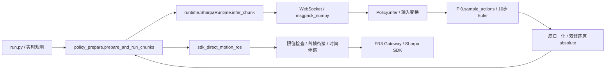

# M0 只读审计与基线

审计基线：`chunk-base-test@64f8f66dbe55a1b2c0b286d6b10f063762e66db4`。开始时工作区干净，无 `.deployment`、真实权重、现场 Home、硬件工程或供应商限位文件。本轮不访问 28 服务器、不启动设备、不训练。

## 实际调用链

- `deploy/fr3_sharpa_runtime/model_loader.py::build_config`：模型原生 58D、horizon 50、Gemma 全量变体；full-delta 启用 `extra_delta_transform=True`。
- `src/openpi/policies/policy_config.py::create_trained_policy`：data 输入变换 → Normalize → model 输入变换；输出为 model 输出变换 → Unnormalize → data 输出变换。
- `src/openpi/transforms.py::DeltaActions/AbsoluteActions`：mask `[0:7,29:36]`，同 chunk 全部动作使用相同起始状态；双手不做 delta。当前 π0.5 使用 quantile normalization，各统计字段为 `(58,)`，不是逐时间点统计。
- `src/openpi/models/pi0.py::sample_actions`：噪声 `(batch,50,58)`，默认10步，`dt=-0.1`，t 从1到0；VLM prefix KV cache 在每轮 Euler 前生成一次。基线没有 inpainting 或相关噪声。
- `policy_prepare.prepare_and_run_chunks`：串行观测、推理、执行；默认15点来自 `run.py`。未执行预测不会跨轮复用。
- `sdk_direct.chunk_command_frames`：从最新状态到首点按0.03 rad/s生成 bridge；随后按倍率重复细分相邻目标，30Hz播放。slow 时15点主体141点、26点主体251点、20点主体191点；均还需加 bridge。
- `sdk_direct_motion_ros` 的 PASS 表示指令发送完成，末帧误差另报；不是任务完成或全关节精确到位证明。
- `run.execute_policy_prepare` 仍拒绝推理后超过200ms的观测，首轮可丢弃一次过期推理并重采；实验不放宽此要求。
- `runtime.py` 每次请求都新开 WebSocket，因此断开正常 socket 不能作为缓存失效事件。新增服务启动 UUID 用来辨别真正重启。

## 时间轴与文档差异

基线默认初始化是 current，只有 `--home` 才回固定 Home；参考研究计划中早期关于默认 Home 的表述不再适用。当前退出流程还包含双手失能确认，须完整保留。

模型30Hz表示预测训练时间基准。执行端桥接、slow/medium伸缩、观测与推理停顿使真实时间不同于动作索引。本次使用“轨迹进度参考”，不声称物理时钟严格重叠，不对延迟做隐式外推。

作者代码在取消压缩时执行20点、保留 `[20:24]`，本次按约定始终消费26点、保留 `[26:30]`。两者已明确区分。

## 基线测试与环境

最初系统 Python 缺 JAX/Flax 等，完整收集失败；暂排除依赖模块时195项通过、5项失败，失败原因是缺模型框架、PyArrow及现场Sharpa限位资产。不是运行时算法失败证据。

创建 `/tmp/sharpa-paper-tests` 隔离 CPU 测试环境，未修改共享 Python。核心版本 JAX/JAXlib0.5.3、Flax0.10.2、Orbax0.11.13、NumPy1.26.4、SciPy1.15.3、Torch2.7.1+cpu、Transformers4.53.2、PyArrow19.0.1；Python3.12.13，非工控机部署环境验收。

两项原有 slew 单元测试原本隐式依赖机器上的限位文件；现改为各测试局部显式的合成 `[-1,1]` 限位，用于验证其本身的变化量拒绝逻辑，不作为供应商 native 范围验收。产品限位加载逻辑未修改。

完整结果、实际命令及新增测试覆盖见 [SYNTHETIC_RESULTS.md](SYNTHETIC_RESULTS.md)。
